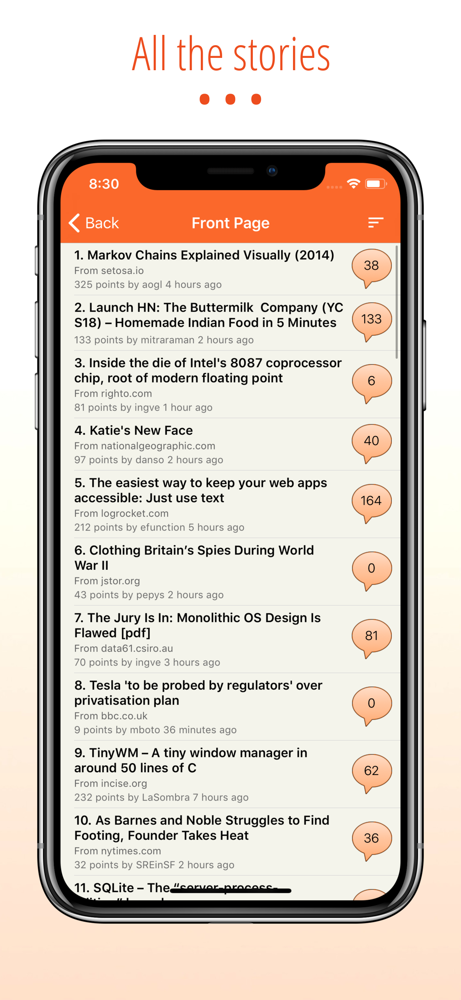
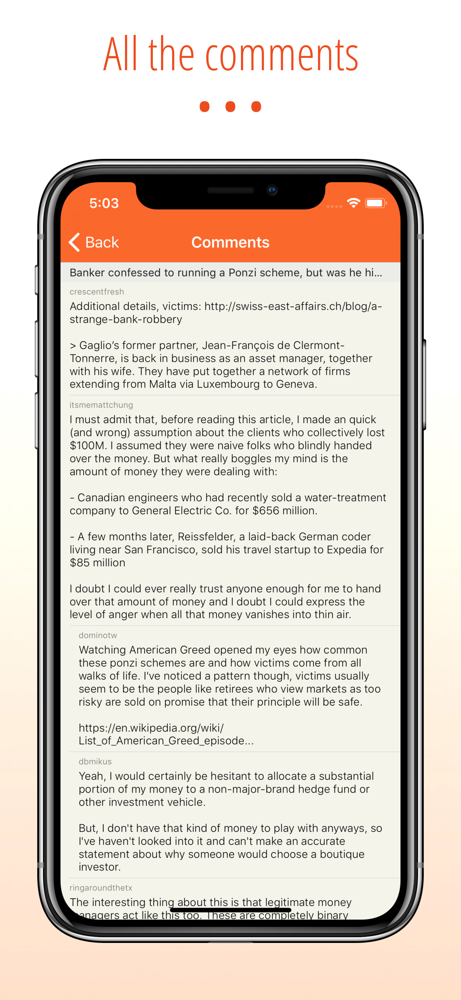
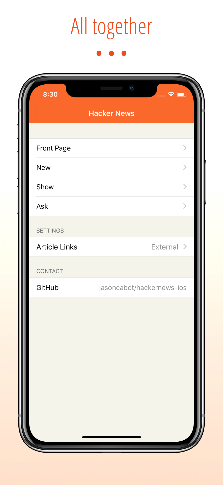

# Hacker News Reader for iOS

## Overview
After my favourite reader app stopped working I decided to write my own as every other one I tried had something missing - and it was a good opportunity to take a look at swift.

## Screenshots






## Building
Requires Xcode 26 or later. Open `HackerNews.xcodeproj` and run the `HackerNews` scheme; there are no external dependencies.

The app is written in SwiftUI and targets iOS 18. Stories come from the [official Hacker News API](https://github.com/HackerNews/API) and comment threads from the [Algolia HN Search API](https://hn.algolia.com/api), which returns a whole thread in one request.

- `HackerNews/` — the SwiftUI app
- `HackerNewsKit/` — a Swift package with the models, API client and HTML parsing

The package's tests run on macOS without a simulator:

```sh
swift test --package-path HackerNewsKit
```

Releases and screenshots use [fastlane](https://fastlane.tools), which needs Ruby 3.2 or later:

```sh
bundle install
bundle exec fastlane screenshots
```

## License
[MIT](LICENSE)
